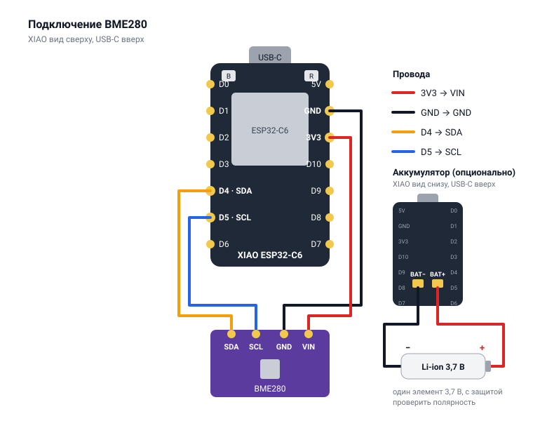

# Termo — термометр для умного дома

Автономный беспроводной датчик температуры, влажности и атмосферного давления для умного дома.
Построен на Seeed Studio XIAO ESP32-C6 и датчике Bosch BME280 и передаёт показания по MQTT,
работает с любой системой, которая понимает MQTT: Home Assistant, Node-RED, openHAB,
«Дом с Алисой» через облачный брокер [WQTT](https://wqtt.ru) и другими.

Большую часть времени устройство проводит в глубоком сне и просыпается только для снятия показаний и их отправки — для экономии заряда.
Wi-Fi и брокер настраиваются с телефона через встроенную веб-страницу.

## Возможности

- Температура, влажность, давление и «ощущается как».
- Глубокий сон между замерами.
- Настройка Wi-Fi и MQTT с телефона через страницу на самой плате.
- MQTT с TLS (`mqtts://`) или без (`mqtt://`).
- Отправка с подтверждением (QoS 1). Не получилось за минуту - замер пропускается, следующий после сна.

## Использование

**Режим настройки** включается сам, если сеть или брокер не сохранены, или вручную:
нажать **R** (RESET), сразу держать **B** (BOOT) 3 секунды. Светодиод загорится.

1. Подключиться к сети **Termo-Setup**, открыть **http://192.168.4.1**.
2. Вкладка **Wi-Fi** - сеть и пароль, вкладка **MQTT** — адрес брокера
   (`mqtt://сервер:порт` или `mqtts://сервер:порт`), логин и пароль.
3. «Завершить настройку».

**Измерить прямо сейчас** — нажать **R**.

| Светодиод | Состояние |
|---|---|
| горит | режим настройки |
| мигает | подключается и отправляет |
| горит 1 секунду | отправлено, дальше сон |
| быстро мерцает 2 секунды | отправить не удалось, дальше сон |

## MQTT-топики

| Топик | Единицы |
|---|---|
| `termo/temperature` | °C |
| `termo/humidity` | % |
| `termo/pressure` | мм рт. ст. |
| `termo/feels_like` | °C |

QoS 1, retain. С датчиком BMP280 (без влажности) — только температура и давление.

## Настройки

В начале [main/main.c](main/main.c):

| Настройка | По умолчанию | |
|---|---|---|
| `SLEEP_SECONDS` | 10 минут | сон между замерами |
| `SEND_TIMEOUT_MS` | 60 секунд | сколько пытаться отправить |
| `LONG_PRESS_MS` | 3 секунды | удержание BOOT для режима настройки |

## Безопасность

Пароли Wi-Fi и MQTT хранятся во флеш-памяти без шифрования. Устройство лучше держать
в отдельной гостевой сети Wi-Fi.

## Железо

- [Seeed Studio XIAO ESP32-C6](https://wiki.seeedstudio.com/xiao_esp32c6_getting_started/)
- модуль BME280 (I2C)
- питание: USB-C от любой зарядки для телефона и/или аккумулятор Li-ion / Li-Po 3,7 В с защитой (к площадкам BAT+ / BAT− снизу платы; от USB заряжается)



## Сборка

Нужен [ESP-IDF v6.1](https://docs.espressif.com/projects/esp-idf/).

1. Создать `main/wifi_secrets.h` с паролем сети `Termo-Setup` (от 8 символов):

   ```c
   #pragma once
   #define SETUP_AP_PASSWORD "пароль"
   ```

2. Собрать и прошить:

   ```bash
   idf.py build flash monitor
   ```

Если плата не прошивается: зажать **B**, нажать и отпустить **R**, отпустить **B**.
